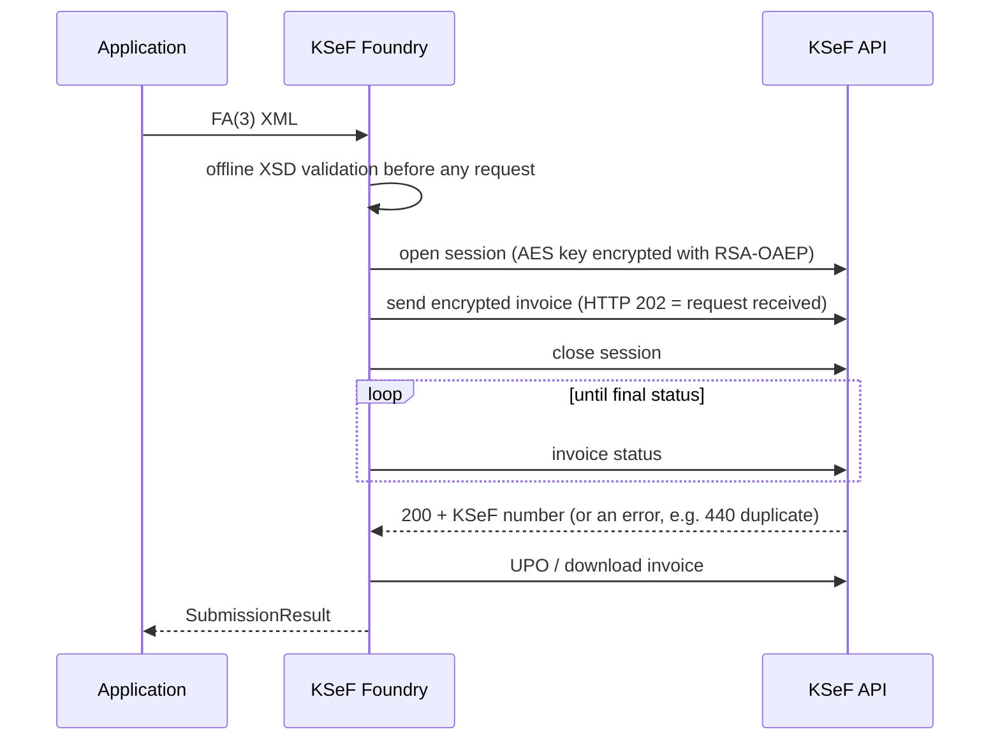

<div align="center">

# KSeF Foundry

**One KSeF API. Two ecosystems. Zero unnecessary complexity.**

Open-source SDKs for Poland's National e-Invoice System (KSeF 2.0) for **PHP / Laravel** and **TypeScript / NestJS**.

[](https://github.com/mysterekkk/ksef-foundry/actions/workflows/ci.yml)
[](LICENSE)
[](https://www.npmjs.com/package/@luroweb/ksef-foundry)
[](https://www.npmjs.com/package/@luroweb/nestjs-ksef-foundry)


-red)

[Polski](README.md) · [English](README.en.md) · [Docs (PL)](docs/pl/index.md) · [Docs (EN)](docs/en/index.md)

</div>

> **Status: v0.1 (early release).** Scope and limitations are stated honestly below. The npm packages (`@luroweb/ksef-foundry`, `@luroweb/nestjs-ksef-foundry`) are **published** on npmjs.com. The Composer packages (`luroweb/ksef-foundry`, `luroweb/laravel-ksef-foundry`) are **prepared** but **not yet on Packagist**.
> This is an independent open-source project, not affiliated with the Polish Ministry of Finance.

## Why KSeF Foundry?

- **Two native SDKs with identical behaviour.** PHP and TypeScript share names, error model and retry rules. A team can run a Laravel backend and a NestJS backend and the integration behaves the same.
- **Ready-made framework adapters.** Laravel: service provider, facade, token cache, queue jobs. NestJS: `KsefModule.forRoot/forRootAsync`, exception filter, health indicator.
- **Secure by default.** Default environment is TEST, TLS cannot be disabled, secrets never reach logs or exceptions, XML is parsed offline without entity expansion.
- **Safe sending.** HTTP 202 is not "accepted". After an ambiguous outcome the SDK **never blindly resends**; it reconciles first by invoice hash.
- **Real FA(3) validation.** Official XSD, offline, exact decimal arithmetic in the builder.
- **Tested for real.** Cryptography, XSD and the KSeF TEST environment are tested without mocks. What the tests prove — and what they do not — is described in the [testing guide](docs/en/testing.md).

Other libraries exist (including the Ministry's official C#/Java clients and independent PHP and TypeScript clients). KSeF Foundry is not the first; its goal is consistent support for two ecosystems with framework adapters and an explicit compatibility model against the official API.

## Supported technologies

| Package | Role | Requirements |
|---|---|---|
| [`luroweb/ksef-foundry`](packages/php) | PHP SDK (PSR-17/18); not yet on Packagist | PHP ≥ 8.2, `ext-openssl`, `ext-dom`, `ext-bcmath` |
| [`luroweb/laravel-ksef-foundry`](packages/laravel) | Laravel adapter; not yet on Packagist | Laravel 12 |
| [`@luroweb/ksef-foundry`](packages/typescript) | TypeScript SDK (ESM, `.d.ts`); [available on npm](https://www.npmjs.com/package/@luroweb/ksef-foundry) | Node ≥ 22 |
| [`@luroweb/nestjs-ksef-foundry`](packages/nestjs) | NestJS adapter; [available on npm](https://www.npmjs.com/package/@luroweb/nestjs-ksef-foundry) | NestJS 11 |

## Quick Start

All examples run against **TEST** by default and create a **synthetic taxpayer** (random NIP/PESEL, self-signed certificate) — no secrets or real data needed.

<details open>
<summary><b>PHP</b></summary>

```bash
composer require luroweb/ksef-foundry   # once published on Packagist; until then use a VCS/path repository (see docs)
```

```php
$nip = SyntheticIdentity::nip();
$pesel = SyntheticIdentity::pesel();
$cert = (new TestCertificateFactory())->personWithPesel($pesel);   // TEST only
$client = KsefClient::create(
    new CertificateCredentials($cert->certificatePem, $cert->privateKeyPem, ContextIdentifier::nip($nip)),
    Environment::test(),
);
$client->testData()->createPerson($nip, $pesel, 'my first test');

$xml = Fa3InvoiceBuilder::sampleXml($nip, 'FV/2026/' . bin2hex(random_bytes(4)));
$result = $client->sender()->submit($xml);          // returns only after status 200 (accepted by KSeF)
echo $result->ksefNumber;
```

Full runnable code: [`examples/php`](examples/php).
</details>

<details>
<summary><b>Laravel</b></summary>

```bash
composer require luroweb/laravel-ksef-foundry
php artisan vendor:publish --tag=ksef-config
```

```dotenv
KSEF_ENVIRONMENT=test
KSEF_CONTEXT_NIP=1111111111   # example; use your own test NIP
KSEF_TOKEN=
```

```php
public function __construct(private readonly \LuroWeb\KsefFoundry\KsefClient $ksef) {}
// ... $this->ksef->query()->iterate(...), SubmitInvoiceJob::dispatch($xml), php artisan ksef:check
```

Details: [`docs/en/laravel.md`](docs/en/laravel.md), example app: [`examples/laravel`](examples/laravel).
</details>

<details>
<summary><b>TypeScript</b></summary>

```bash
npm install @luroweb/ksef-foundry
```

```ts
import { KsefClient, KsefTokenCredentials, Context, Environment, Fa3InvoiceBuilder } from '@luroweb/ksef-foundry';

const client = KsefClient.create({
  environment: Environment.TEST,
  credentials: new KsefTokenCredentials(process.env.KSEF_TOKEN!, Context.nip(process.env.KSEF_CONTEXT_NIP!)),
});
const xml = await Fa3InvoiceBuilder.sampleXml(process.env.KSEF_CONTEXT_NIP!, `FV/${Date.now()}`);
const result = await client.sender.submit(xml);     // returns only after status 200
console.log(result.ksefNumber);
```

Runnable examples: [`examples/typescript`](examples/typescript).
</details>

<details>
<summary><b>NestJS</b></summary>

```ts
@Module({
  imports: [
    KsefModule.forRootAsync({
      imports: [ConfigModule],
      inject: [ConfigService],
      useFactory: (cfg: ConfigService) => ({ /* environment, credentials from ConfigService */ }),
    }),
  ],
})
export class AppModule {}
// constructor(private readonly ksef: KsefService) {}
```

Details: [`docs/en/nestjs.md`](docs/en/nestjs.md), working app: [`examples/nestjs`](examples/nestjs).
</details>

## Features and real status

Legend: **live** — verified live against the KSeF TEST environment · **local** — verified only against a real local HTTP server (fault injection) · **—** not implemented.

| Feature | PHP | TypeScript | Laravel / NestJS |
|---|---|---|---|
| KSeF token authentication | live | live | live |
| Certificate authentication (XAdES-BES, RSA and ECDSA, self-signed certificate) | live | live | live |
| JWT cache, refresh, re-login, context isolation | live | live | framework cache/lock |
| KSeF token management (`/tokens`) | live | live | — |
| Interactive session, AES + RSA-OAEP encryption, FA(3) send up to status 200 | live | live | live |
| KSeF number, invoice download (hash check), invoice and session UPO | live | live | live |
| Duplicate detection (440), reconciliation after an ambiguous outcome | live / local | live / local | local |
| Metadata queries with pagination (windows ≤ 100 days) | live | live | live |
| Limits, authentication sessions | live | live | live |
| FA(3) builder + offline XSD validation | yes | yes (byte-identical to PHP) | yes |
| 429 + `Retry-After`, 5xx, timeout, connection reset | local | local | local |
| Batch sessions, exports, permissions, KSeF certificate enrollment, offline modes, QR codes, corrections/advances | — | — | — |

FA(3) scope: standard VAT invoice in PLN (rates 23/22/8/7/5, 0 KR/EX/WDT, zw, np I/II). Full list of supported and unsupported variants: [`docs/dev/fa3-scope.md`](docs/dev/fa3-scope.md).

## KSeF environments

| Environment | URL | Notes |
|---|---|---|
| **TEST** (default) | `https://api-test.ksef.mf.gov.pl/v2` | self-signed certificates, synthetic data, shared environment |
| **DEMO** | `https://api-demo.ksef.mf.gov.pl/v2` | pre-production, needs real entitlements; **not used in tests** |
| **PRODUCTION** | `https://api.ksef.mf.gov.pl/v2` | legal effect; must be selected explicitly; **not used in tests** |

Tokens and certificates are not portable between environments. Details: [docs/en/environments.md](docs/en/environments.md).

## Authentication

- **KSeF token** — long-lived secret; the SDK exchanges it for a short-lived JWT (+ refresh token) and stores only the JWT pair, never the KSeF token itself.
- **Certificate (XAdES)** — recommended for new production integrations.
- **Important:** the legal status of tokens after 31 Dec 2026 is unsettled (the Ministry announces they stay; the regulation text still states that date). Check current Ministry announcements — see [docs/api-compatibility.md](docs/api-compatibility.md).
- **Verified live:** self-signed certificate (TEST). **Not verified:** qualified certificates and KSeF Authentication certificates, `certificateFingerprint`. Offline certificates must not be used for authentication.

## Invoice lifecycle



## Error handling

```ts
try { await client.sender.submit(xml); }
catch (e) {
  if (e instanceof RateLimitException) { /* wait e.retryAfterSeconds */ }
  else if (e instanceof AuthorizationException) { /* missing permissions: e.diagnostics() */ }
  else if (e instanceof InvoiceRejectedException) { /* rejected by KSeF */ }
  else if (e instanceof UnknownOutcomeException) { /* do NOT resend; reconcile first */ }
}
```

The same classes exist in PHP. Retry matrix and full hierarchy: [docs/en/error-handling.md](docs/en/error-handling.md).

## Security

TLS always on, no cross-host redirects, URLs from API responses are never followed, XML without DTD/entities/network, secrets never in logs or exceptions, taxpayer isolation in the token cache. Safe-use rules: [docs/en/security.md](docs/en/security.md). Reporting vulnerabilities: [SECURITY.md](SECURITY.md).

## Compatibility

Verified contract version: **KSeF API 2.9.0** (TEST, DEMO, PRODUCTION; checked 2026-11-13). OpenAPI and XSD files live in [`schemas/`](schemas) with SHA-256 sums. Contract changes are detected by `scripts/check-openapi-drift.mjs` (a weekly workflow opens an issue; it **never** updates the SDK automatically). Details: [docs/api-compatibility.md](docs/api-compatibility.md).

## Tests — what they prove and what they do not

Project rule: **no mocks for logic that can be run for real**. Cryptography, XSD and the KSeF TEST API are tested for real. Scenarios the real API cannot produce on demand (429, 5xx, timeouts, resets) are covered by *fault-injection* tests against a real local HTTP server — **these are not proof of KSeF compatibility**. Live tests are opt-in (`KSEF_LIVE_TEST=1`), run against TEST only, need no secrets, and a run that did not happen is reported as `SKIPPED`, never as a pass.

Results at release preparation: [docs/dev/test-report.md](docs/dev/test-report.md).

## Contributing and support

[CONTRIBUTING.md](CONTRIBUTING.md) · issues and questions: [GitHub Issues](https://github.com/mysterekkk/ksef-foundry/issues).

## Need a custom KSeF integration?

Built and maintained by **LuroWeb**. LuroWeb helps businesses integrate KSeF with custom applications, internal systems and business workflows. The library is and stays free (MIT); commercial services are optional. Contact: [author's GitHub profile](https://github.com/mysterekkk). See [docs/commercial-integrations.md](docs/commercial-integrations.md).

## License

MIT © LuroWeb. The XSD schemas and OpenAPI specifications in `schemas/` come from [CIRFMF/ksef-api](https://github.com/CIRFMF/ksef-api) (MIT, Ministry of Finance) — see [NOTICE](NOTICE).
