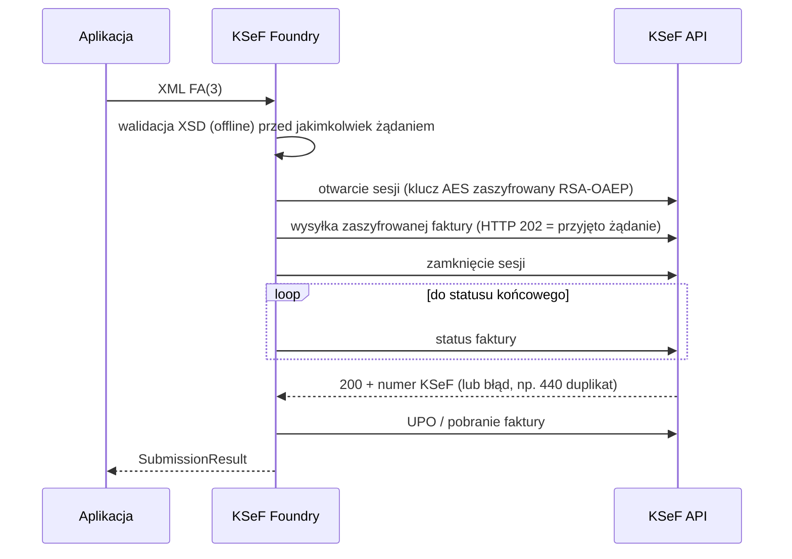

<div align="center">

# KSeF Foundry

**One KSeF API. Two ecosystems. Zero unnecessary complexity.**

Otwarte SDK do integracji z Krajowym Systemem e-Faktur (KSeF 2.0) dla **PHP / Laravel** oraz **TypeScript / NestJS**.

[](https://github.com/mysterekkk/ksef-foundry/actions/workflows/ci.yml)
[](LICENSE)


-red)

[Polski](README.md) · [English](README.en.md) · [Dokumentacja](docs/pl/index.md) · [Docs EN](docs/en/index.md)

</div>

> **Status: v0.1 (wczesne wydanie).** Zakres i ograniczenia opisano uczciwie poniżej. Pakiety są **przygotowane** do publikacji w Packagist i npm, ale **nie zostały jeszcze opublikowane**.
> To niezależny projekt open source, niepowiązany z Ministerstwem Finansów.

## Dlaczego KSeF Foundry?

- **Dwa natywne SDK o tym samym zachowaniu.** PHP i TypeScript mają te same nazwy, ten sam model błędów i te same reguły ponawiania. Zespół może mieć backend w Laravelu i w NestJS, a integracja zachowuje się identycznie.
- **Gotowe adaptery frameworkowe.** Provider, fasada, cache tokenów i kolejki w Laravelu; `KsefModule.forRoot/forRootAsync`, filtr wyjątków i health-check w NestJS.
- **Bezpieczeństwo domyślnie.** Domyślne środowisko to TEST, TLS nie da się wyłączyć, sekrety nie trafiają do logów ani wyjątków, XML jest parsowany bez sieci i bez rozwijania encji.
- **Bezpieczna wysyłka.** HTTP 202 nie jest „przyjęciem”. Po niejednoznacznym wyniku SDK **nie wysyła ponownie na ślepo** — najpierw sprawdza stan sesji (rekoncyliacja po skrócie faktury).
- **Prawdziwa walidacja FA(3).** Oficjalny XSD, offline, z dokładną arytmetyką dziesiętną w builderze.
- **Testowane naprawdę.** Kryptografia, XSD i środowisko TEST KSeF są testowane bez mocków. Dowody i granice tych dowodów opisano w [dokumentacji testów](docs/pl/testowanie.md).

Na rynku są inne biblioteki (m.in. oficjalne klienty C#/Java Ministerstwa Finansów oraz niezależne klienty PHP i TypeScript). KSeF Foundry nie jest pierwsze — jego celem jest spójne wsparcie dwóch ekosystemów z adapterami frameworkowymi i jawnym modelem zgodności z oficjalnym API.

## Obsługiwane technologie

| Pakiet | Rola | Wymagania |
|---|---|---|
| [`luroweb/ksef-foundry`](packages/php) | SDK PHP (PSR-17/18) | PHP ≥ 8.2, `ext-openssl`, `ext-dom`, `ext-bcmath` |
| [`luroweb/laravel-ksef-foundry`](packages/laravel) | Adapter Laravel | Laravel 11 / 12 |
| [`@luroweb/ksef-foundry`](packages/typescript) | SDK TypeScript (ESM, `.d.ts`) | Node ≥ 22 |
| [`@luroweb/nestjs-ksef-foundry`](packages/nestjs) | Adapter NestJS | NestJS 11 |

## Quick Start

Wszystkie przykłady domyślnie działają na **TEST** i tworzą **syntetycznego podatnika** (losowy NIP/PESEL, certyfikat samopodpisany) — nie potrzebujesz żadnych sekretów ani prawdziwych danych.

<details open>
<summary><b>PHP</b></summary>

```bash
composer require luroweb/ksef-foundry   # po publikacji w Packagist; do tego czasu: repozytorium VCS/path (zob. docs)
```

```php
$nip = SyntheticIdentity::nip();
$pesel = SyntheticIdentity::pesel();
$cert = (new TestCertificateFactory())->personWithPesel($pesel);   // tylko TEST
$client = KsefClient::create(
    new CertificateCredentials($cert->certificatePem, $cert->privateKeyPem, ContextIdentifier::nip($nip)),
    Environment::test(),
);
$client->testData()->createPerson($nip, $pesel, 'moj pierwszy test');

$xml = Fa3InvoiceBuilder::sampleXml($nip, 'FV/2026/' . bin2hex(random_bytes(4)));
$result = $client->sender()->submit($xml);          // zwraca dopiero po statusie 200 (przyjęta przez KSeF)
echo $result->ksefNumber;
```

Pełny, uruchamialny kod: [`examples/php`](examples/php).
</details>

<details>
<summary><b>Laravel</b></summary>

```bash
composer require luroweb/laravel-ksef-foundry
php artisan vendor:publish --tag=ksef-config
```

```dotenv
KSEF_ENVIRONMENT=test
KSEF_CONTEXT_NIP=1111111111   # przykład; użyj własnego NIP testowego
KSEF_TOKEN=
```

```php
public function __construct(private readonly \LuroWeb\KsefFoundry\KsefClient $ksef) {}
// ... $this->ksef->query()->iterate(...), SubmitInvoiceJob::dispatch($xml), php artisan ksef:check
```

Szczegóły: [`docs/pl/laravel.md`](docs/pl/laravel.md), przykładowa aplikacja: [`examples/laravel`](examples/laravel).
</details>

<details>
<summary><b>TypeScript</b></summary>

```bash
npm install @luroweb/ksef-foundry   # po publikacji w npm; do tego czasu: npm pack z repozytorium (zob. docs)
```

```ts
import { KsefClient, KsefTokenCredentials, Context, Environment, Fa3InvoiceBuilder } from '@luroweb/ksef-foundry';

const client = KsefClient.create({
  environment: Environment.TEST,
  credentials: new KsefTokenCredentials(process.env.KSEF_TOKEN!, Context.nip(process.env.KSEF_CONTEXT_NIP!)),
});
const xml = await Fa3InvoiceBuilder.sampleXml(process.env.KSEF_CONTEXT_NIP!, `FV/${Date.now()}`);
const result = await client.sender.submit(xml);     // zwraca dopiero po statusie 200
console.log(result.ksefNumber);
```

Uruchamialne przykłady: [`examples/typescript`](examples/typescript).
</details>

<details>
<summary><b>NestJS</b></summary>

```ts
@Module({
  imports: [
    KsefModule.forRootAsync({
      imports: [ConfigModule],
      inject: [ConfigService],
      useFactory: (cfg: ConfigService) => ({ /* environment, credentials z ConfigService */ }),
    }),
  ],
})
export class AppModule {}
// constructor(private readonly ksef: KsefService) {}
```

Szczegóły: [`docs/pl/nestjs.md`](docs/pl/nestjs.md), działająca aplikacja: [`examples/nestjs`](examples/nestjs).
</details>

## Funkcje i rzeczywisty status

Legenda: **live** — sprawdzone na żywo na środowisku TEST KSeF · **lokalnie** — sprawdzone tylko przeciwko prawdziwemu lokalnemu serwerowi HTTP (fault-injection) · **—** nie zaimplementowano.

| Funkcja | PHP | TypeScript | Laravel / NestJS |
|---|---|---|---|
| Uwierzytelnianie tokenem KSeF | live | live | live |
| Uwierzytelnianie certyfikatem (XAdES-BES, RSA i ECDSA, certyfikat samopodpisany) | live | live | live |
| Cache JWT, refresh, ponowne logowanie, izolacja kontekstów | live | live | cache/lock w frameworku |
| Zarządzanie tokenami KSeF (`/tokens`) | live | live | — |
| Sesja interaktywna, szyfrowanie AES + RSA-OAEP, wysyłka FA(3) do statusu 200 | live | live | live |
| Numer KSeF, pobranie faktury (weryfikacja skrótu), UPO faktury i sesji | live | live | live |
| Wykrywanie duplikatów (440), rekoncyliacja po niejednoznacznym wyniku | live / lokalnie | live / lokalnie | lokalnie |
| Zapytania o metadane z paginacją (okna ≤ 100 dni) | live | live | live |
| Limity, sesje uwierzytelnienia | live | live | live |
| Builder FA(3) + walidacja XSD offline | tak | tak (bajt w bajt jak PHP) | tak |
| 429 + `Retry-After`, 5xx, timeout, reset połączenia | lokalnie | lokalnie | lokalnie |
| Sesja wsadowa, eksport paczek, uprawnienia, certyfikaty KSeF (enrollment), tryby offline, kody QR, korekty/zaliczki | — | — | — |

Zakres FA(3): standardowa faktura VAT w PLN (stawki 23/22/8/7/5, 0 KR/EX/WDT, zw, np I/II). Pełna lista obsługiwanych i nieobsługiwanych wariantów: [`docs/dev/fa3-scope.md`](docs/dev/fa3-scope.md).

## Środowiska KSeF

| Środowisko | Adres | Uwagi |
|---|---|---|
| **TEST** (domyślne) | `https://api-test.ksef.mf.gov.pl/v2` | samopodpisane certyfikaty, dane syntetyczne, środowisko współdzielone |
| **DEMO** | `https://api-demo.ksef.mf.gov.pl/v2` | przedprodukcyjne, wymaga prawdziwych uprawnień; **nieużywane w testach** |
| **PRODUCTION** | `https://api.ksef.mf.gov.pl/v2` | skutki prawne; wymaga jawnego wyboru; **nieużywane w testach** |

Tokeny i certyfikaty nie są przenoszone między środowiskami. Szczegóły: [docs/pl/srodowiska.md](docs/pl/srodowiska.md).

## Uwierzytelnianie

- **Token KSeF** — długotrwały sekret; SDK wymienia go na krótkotrwały JWT (+ refresh token) i przechowuje wyłącznie parę JWT, nigdy samego tokenu KSeF.
- **Certyfikat (XAdES)** — zalecany dla nowych integracji produkcyjnych.
- **Ważne:** status prawny tokenów po 31.12.2026 jest niejednoznaczny (MF zapowiada utrzymanie, rozporządzenie nadal wskazuje tę datę). Sprawdź aktualne komunikaty MF — zob. [docs/api-compatibility.md](docs/api-compatibility.md#4-metody-uwierzytelniania--stan-prawny-token%C3%B3w-ksef-stan-na-2026-11-13).
- **Zweryfikowane na żywo:** certyfikat samopodpisany (TEST). **Niezweryfikowane:** certyfikaty kwalifikowane i certyfikat KSeF (Authentication), `certificateFingerprint`. Certyfikatów Offline nie wolno używać do uwierzytelniania.

## Cykl życia faktury



## Obsługa błędów

```ts
try { await client.sender.submit(xml); }
catch (e) {
  if (e instanceof RateLimitException) { /* odczekaj e.retryAfterSeconds */ }
  else if (e instanceof AuthorizationException) { /* brak uprawnień: e.diagnostics() */ }
  else if (e instanceof InvoiceRejectedException) { /* odrzucona przez KSeF */ }
  else if (e instanceof UnknownOutcomeException) { /* NIE wysyłaj ponownie; najpierw reconcile */ }
}
```

Te same klasy istnieją w PHP. Macierz ponawiania i pełna hierarchia: [docs/pl/obsluga-bledow.md](docs/pl/obsluga-bledow.md).

## Bezpieczeństwo

TLS zawsze włączony, brak podążania za przekierowaniami między hostami, adresy URL z odpowiedzi API nie są wykonywane, XML bez DTD/encji/sieci, sekrety nigdy w logach i wyjątkach, izolacja podatników w cache tokenów. Zasady bezpiecznego użycia: [docs/pl/bezpieczenstwo.md](docs/pl/bezpieczenstwo.md). Zgłaszanie podatności: [SECURITY.md](SECURITY.md).

## Zgodność

Weryfikowana wersja kontraktu: **KSeF API 2.9.0** (TEST, DEMO, PRODUCTION; sprawdzone 2026-11-13). Pliki OpenAPI i XSD są w [`schemas/`](schemas) z sumami SHA-256. Zmiany kontraktu wykrywa skrypt `scripts/check-openapi-drift.mjs` (cotygodniowy workflow tworzy zgłoszenie; **nigdy** nie aktualizuje SDK automatycznie). Szczegóły: [docs/api-compatibility.md](docs/api-compatibility.md).

## Testy — czego dowodzą, a czego nie

Zasada projektu: **bez mocków dla logiki, którą da się uruchomić naprawdę**. Kryptografia, XSD i API TEST KSeF są testowane naprawdę. Scenariuszy, których prawdziwe API nie wywoła na żądanie (429, 5xx, timeout, reset), dotyczą testy *fault-injection* na prawdziwym lokalnym serwerze HTTP — **nie są one dowodem zgodności z KSeF**. Testy live są opcjonalne (`KSEF_LIVE_TEST=1`), działają wyłącznie na TEST, nie potrzebują sekretów, a brak uruchomienia jest raportowany jako `SKIPPED`, nigdy jako sukces.

Wyniki z dnia przygotowania wydania: [docs/dev/test-report.md](docs/dev/test-report.md).

## Współtworzenie i wsparcie

[CONTRIBUTING.md](CONTRIBUTING.md) · zgłoszenia i pytania: [GitHub Issues](https://github.com/mysterekkk/ksef-foundry/issues).

## Potrzebujesz integracji szytej na miarę?

Zbudowane i utrzymywane przez **LuroWeb**. LuroWeb pomaga firmom integrować KSeF z aplikacjami na zamówienie, systemami wewnętrznymi i procesami biznesowymi. Biblioteka jest i pozostanie darmowa (MIT) — usługi komercyjne są opcjonalne. Kontakt: [profil autora na GitHub](https://github.com/mysterekkk). Zob. [docs/commercial-integrations.md](docs/commercial-integrations.md).

## Licencja

MIT © LuroWeb. Schematy XSD i specyfikacje OpenAPI w `schemas/` pochodzą z [CIRFMF/ksef-api](https://github.com/CIRFMF/ksef-api) (MIT, Ministerstwo Finansów) — zob. [NOTICE](NOTICE).
