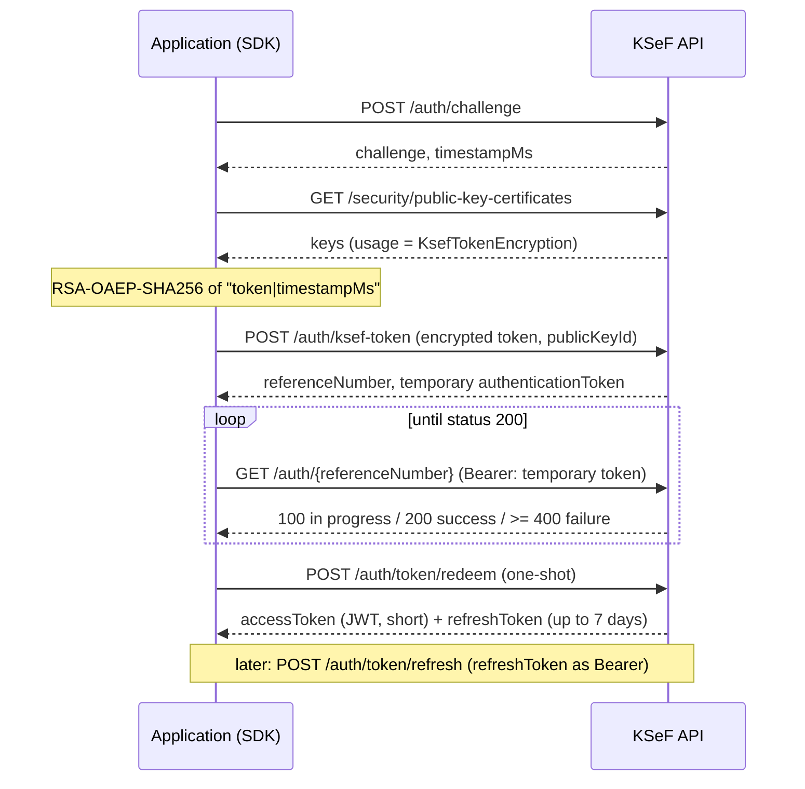
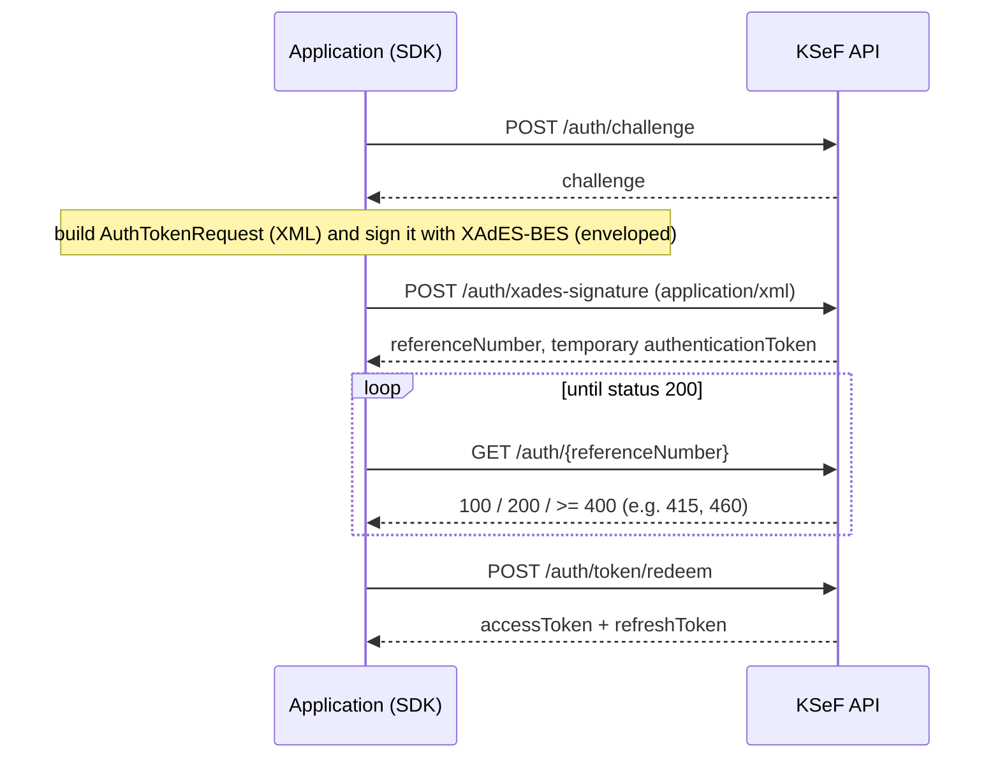

# Authentication

The SDK supports two login methods for KSeF API 2.0: a **KSeF token** and a **certificate** (XAdES-BES signature). This guide describes both flows, what has been verified, the limitations, and how JWTs are managed.

## Contents

- [Which method to choose](#which-method-to-choose)
- [KSeF token flow](#ksef-token-flow)
- [Certificate flow (XAdES)](#certificate-flow-xades)
- [What is verified and what is not](#what-is-verified-and-what-is-not)
- [JWT, refresh and re-login](#jwt-refresh-and-re-login)
- [Tenant isolation (tenant key)](#tenant-isolation-tenant-key)
- [TokenStorage](#tokenstorage)
- [Status 415 right after /testdata/person](#status-415-right-after-testdataperson)
- [Protecting secrets](#protecting-secrets)

## Which method to choose

| | KSeF token | Certificate |
|---|---|---|
| Credential | a long-lived token created by `POST /tokens` | certificate + private key |
| Class (PHP / TS) | `KsefTokenCredentials` | `CertificateCredentials` |
| Live verification (TEST) | yes | yes, but only a **self-signed** certificate |
| Legal status | unsettled (see below) | independent of the token decision |

**The legal status of KSeF tokens (as of 2026-11-13) is unsettled.** The MF page about KSeF certificates and the August edition of the KSeF 2.0 Handbook say the token will be kept indefinitely (until revoked by the user). Older materials and the regulation in force (Dz.U. 2025 item 1815, § 13, per issue [CIRFMF/ksef-api#834](https://github.com/CIRFMF/ksef-api/issues/834)) point to 31 December 2026; a draft amendment dated 30 November 2027 is also in circulation. We have not confirmed publication of an amending act.

**Recommendation:** for new production integrations use a **KSeF (Authentication) certificate**. If you use a token, watch Ministry of Finance announcements and the Journal of Laws. Note: login with a KSeF-issued or qualified certificate **has not yet been verified live** (see below).

## KSeF token flow



Implementation details: the token is encrypted as `"{token}|{timestampMs}"` with a key whose usage is `KsefTokenEncryption` (RSA-OAEP with SHA-256 and MGF1-SHA256). `redeem` is a one-shot operation and is **never retried automatically** after an ambiguous failure. If KSeF returns code 21470 (unknown public key, for example after rotation), the SDK refetches the keys and tries once more (once only); this path was checked only against a local server, not live.

## Certificate flow (XAdES)



- The `AuthTokenRequest` document uses the namespace `http://ksef.mf.gov.pl/auth/token/2.1` (XSD v2-1). TEST also accepted `…/2.0` from the guide's examples; the SDK uses 2.1.
- Signature: XAdES-BES enveloped, RSA >= 2048 or ECDSA >= P-256, SHA-256 digest.
- Signature errors (codes 9101, 9102, 9105) come back **synchronously** from `POST /auth/xades-signature` as HTTP 400. Certificate or permission problems (statuses 415, 460) show up only while polling the status.
- **Offline certificates are not accepted** by KSeF for authentication.
- `subjectIdentifierType`: `certificateSubject` by default. `certificateFingerprint` exists but was not checked live.

Example (PHP / TypeScript), certificate from files:

```php
new CertificateCredentials(file_get_contents('cert.pem'), new SensitiveString($keyPem), ContextIdentifier::nip($nip));
```

```ts
new CertificateCredentials({ certificatePem, privateKeyPem, passphrase, context: Context.nip(nip) });
```

## What is verified and what is not

**Verified live (TEST, 2026-11-13, synthetic data):**

- XAdES login with a self-signed personal certificate (`serialNumber = PNOPL-<pesel>`), RSA 2048 and ECDSA P-256, `certificateSubject`, `Nip` context,
- creating a token with `POST /tokens`, KSeF token login, JWT refresh,
- reading authentication sessions and listing tokens.

**Not verified live:**

- qualified certificates (seal, signature) and a KSeF-issued Authentication certificate,
- `certificateFingerprint`,
- contexts other than NIP (`InternalId`, `NipVatUe`, `PeppolId`); for `NipVatUe`, the official authentication XSD has a `TNipVatUE` pattern ending in a literal `$`, so no value satisfies it, and the XSD test skips that context,
- the DEMO and PRODUCTION environments.

## JWT, refresh and re-login

`AuthenticationManager` (`$client->auth()` in PHP, `client.authentication` in TypeScript) manages the tokens:

- The `accessToken` (JWT) is short-lived; the `refreshToken` is valid for up to 7 days. The SDK stores the pair and the expiry declared by the server.
- A refresh happens when less than **60 s** remain before expiry (`expirySkewSeconds`; via `AuthOptions` in PHP, a client option in TypeScript).
- If the refresh is rejected (401/403/400) or the refresh token has expired, **one** full re-login is performed.
- Concurrent calls for the same taxpayer share a single login or refresh operation (*single-flight*). In TypeScript this is a map of in-flight operations. In PHP it is an in-process guard (cooperating with `Fiber`) plus an optional cross-process lock (`KsefClientBuilder::lock()`); the Laravel adapter wires in `Cache::lock`.
- Maximum time to wait for the asynchronous login to finish: 120 s.
- The SDK **does not decode the JWT for authorisation**; it uses only the server-declared expiry to schedule refreshes. The server is the authority.
- The JWT `iat` has 1 s resolution: a refresh within the same second returns an identical access token.
- Errors: missing permissions (authentication status 415) raises `AuthorizationException`; other login failures raise `AuthenticationException`. Both carry the authentication status code (`authStatusCode()` in PHP, `authStatusCode` in TypeScript). Retry loops for 415 should read that field, not `statusCode()`.

`$client->auth()->forget($credentials)` (PHP) and `client.authentication.invalidate(...)` drop cached tokens; they do not revoke the session on the server. To revoke, use `client.logout()` (TypeScript) or the authentication-sessions service (`authSessions`).

## Tenant isolation (tenant key)

The token cache is keyed by:

```text
sha256( environment | context type | context value | auth method | credential fingerprint )
```

Two taxpayers (contexts), two different credentials or two environments **never share tokens**. The credential fingerprint is an irreversible hash (SHA-256 of the token, or of the certificate). One `KsefClient` corresponds to one credential set and one context; for several taxpayers create several clients (Laravel: `KsefManager::tenant()`, NestJS: the registry of named clients).

## TokenStorage

By default the JWT pair is kept in process memory (`InMemoryTokenStorage`). You plug in your own implementation through an interface:

```php
// PHP: LuroWeb\KsefFoundry\Auth\TokenStorageInterface
public function get(string $key): ?TokenPair;
public function put(string $key, TokenPair $pair, int $ttlSeconds): void;
public function delete(string $key): void;
// KsefClient::builder()->tokenStorage($storage)
```

```ts
// TypeScript: TokenStorage
get(key: string): Promise<TokenPair | undefined>;
put(key: string, pair: TokenPair, ttlSeconds: number): Promise<void>;
delete(key: string): Promise<void>;
// KsefClient.create({ credentials, storage })
```

Rules:

- **Only** the JWT pair reaches the storage. The long-lived KSeF token and the private key never do.
- `ttlSeconds` is the remaining lifetime of the refresh token (at least 1).
- A refresh token is a credential valid for up to 7 days: encrypt data at rest and restrict access. The Laravel adapter encrypts the pair with `APP_KEY`. The `FileTokenStorage` in `examples/nestjs` writes a file with 0600 permissions and is an illustration only; in production use an encrypted cache or a secret store.
- A storage shared between processes (Redis, database) avoids redundant logins, but needs a login lock so workers do not log in simultaneously.

## Status 415 right after /testdata/person

On TEST, the `/testdata/person` endpoint takes a few seconds to take effect. XAdES login right after creating a person may end with authentication status **415 "No permissions assigned"**; the same request a few seconds later succeeds. The SDK maps this to `AuthorizationException`, and the examples retry (at most 8 times, 2 s apart):

```ts
const status = (e as { authStatusCode?: number }).authStatusCode;
if (status !== 415 || i >= attempts) throw e;
await new Promise((r) => setTimeout(r, 2000));
```

In production the same status 415 genuinely means missing permissions in the context; do not retry it indefinitely.

## Protecting secrets

- The token, private key, JWTs, refresh token and `Authorization` header are wrapped (`SensitiveString`) and never reach logs, exceptions, `var_dump`, `console.log` or `util.inspect` (`[REDACTED]` replaces them).
- Keep the token and private key in a secret manager, not in the repository.
- Use separate credentials for each environment ([Environments](environments.md)).

More: [Security](security.md).

---

Built and maintained by LuroWeb.
