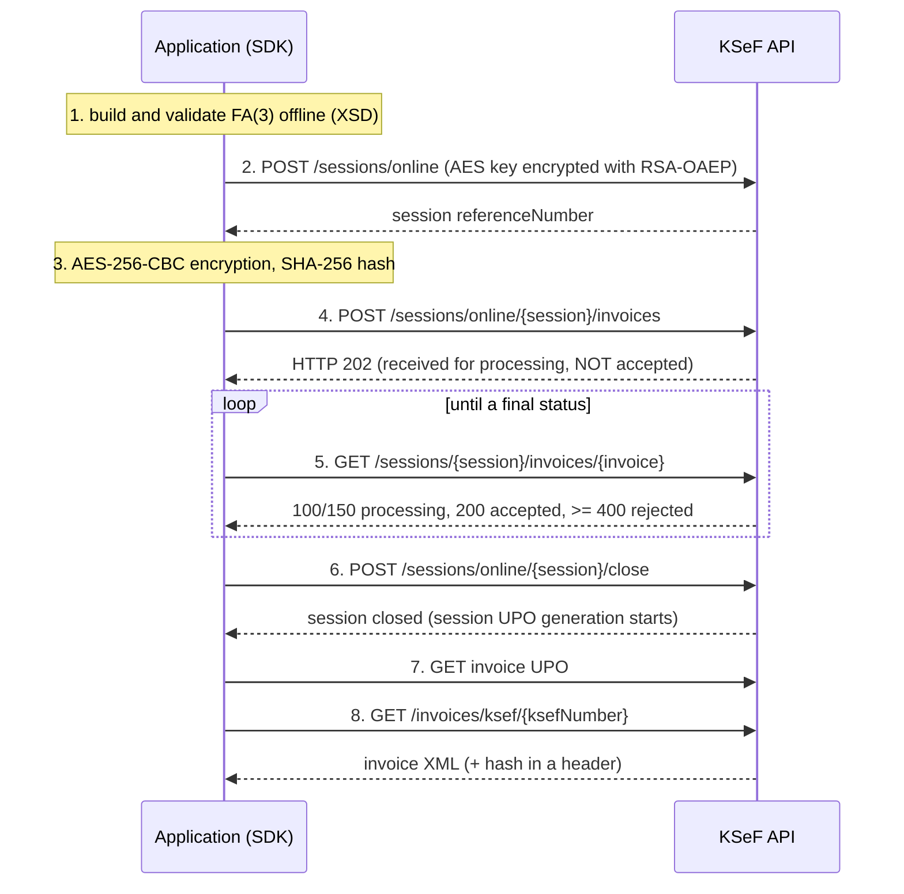

# Invoice lifecycle

This guide describes what happens from building an invoice to downloading it from KSeF, and how the SDK protects against duplicates. It covers the interactive (online) session. Batch sessions are **not implemented**.

## Contents

- [The flow](#the-flow)
- [Sending with one call](#sending-with-one-call)
- [Sending step by step](#sending-step-by-step)
- [HTTP 202 does not mean accepted](#http-202-does-not-mean-accepted)
- [Duplicates (code 440)](#duplicates-code-440)
- [Unknown outcome and reconcile](#unknown-outcome-and-reconcile)
- [Downloading an invoice and error 21165](#downloading-an-invoice-and-error-21165)
- [UPO](#upo)
- [Querying invoices and pagination](#querying-invoices-and-pagination)

## The flow



The session key (32 random bytes) and IV (16 bytes) are generated **per session**; the key is encrypted with RSA-OAEP (SHA-256, MGF1-SHA256) using a public key whose usage is `SymmetricKeyEncryption`. The invoice is encrypted with AES-256-CBC and PKCS#7 padding; KSeF receives the hash and size of both the plain and the encrypted content. Key material is kept in memory only.

## Sending with one call

`submit()` performs validation, session open, send, waiting for a final status and session close. It returns **only after status 200** and a KSeF number.

```php
// PHP (examples/php/src/03-send-invoice.php)
$xml = Fa3InvoiceBuilder::sampleXml($nip, 'FV/EX/' . time());
$result = $client->sender()->submit($xml);
echo $result->ksefNumber;
$upo = $client->upo()->invoiceUpo($result->sessionReferenceNumber, $result->invoiceReferenceNumber);
$doc = $client->invoices()->download($result->ksefNumber);   // $doc->xml, $doc->hashVerified
```

```ts
// TypeScript (examples/typescript/src/03-send-invoice.ts)
const xml = await Fa3InvoiceBuilder.sampleXml(nip, `FV/EX/${String(Date.now())}`);
const result = await client.sender.submit(xml);
console.log(result.ksefNumber);
const upo = await client.upo.getInvoiceUpoByKsefNumber(result.sessionReferenceNumber, result.ksefNumber);
const downloaded = await client.invoices.getByKsefNumber(result.ksefNumber); // downloaded.hashMatches
```

`SubmissionResult` contains the KSeF number, the invoice and session reference numbers, the invoice hash and an `upoAvailable` flag. The default wait for a final status is 120 s (PHP: `SubmitOptions::$awaitTimeoutSeconds`; TypeScript: `submit(xml, { await: { timeoutMs } })`); when exceeded, a `TimeoutException` is raised. Polling grows the interval from 1 s to 5 s.

## Sending step by step

When you need control (several invoices in one session, your own queue), use the session service:

```php
$sessions = $client->sessions();
$session = $sessions->openOnline();                       // FormCode FA (3) by default
$sent = $sessions->sendInvoice($session, $xml);           // validates the XML, encrypts, sends
$status = $sessions->awaitInvoice($session->referenceNumber, $sent->referenceNumber);
$sessions->close($session);
echo $status->ksefNumber;
```

```ts
const session = await client.sessions.openOnline();
const sent = await client.sessions.sendInvoice(session, xml);
const inv = await client.sessions.awaitInvoice(session.referenceNumber, sent.referenceNumber);
await client.sessions.close(session);
console.log(inv.ksefNumber);
```

Also available: `getStatus(session)`, `getInvoiceStatus(session, invoice)`, `listSessionInvoices` / `iterateSessionInvoices`, `listFailedInvoices`. Closing an **empty** session (no invoices) ends on TEST with status 440 "Session cancelled", not 200. `awaitInvoice` itself raises `InvoiceRejectedException` when the final status is 400 or above.

## HTTP 202 does not mean accepted

A 202 response to a send only means "received". The invoice can still be rejected (for example by KSeF-side validation, or as a duplicate). The SDK **never reports success without status 200**: `submit()` and `awaitInvoice()` succeed only on 200 and return the KSeF number. Statuses: 100 and 150 mean processing, 200 accepted, >= 400 rejected.

## Duplicates (code 440)

KSeF rejects duplicates: the key is the seller NIP, the invoice type and the invoice number. A 440 status carries `originalKsefNumber` and `originalSessionReferenceNumber` in its extensions; the SDK exposes them on `InvoiceRejectedException` (`statusExtensions()` in PHP, `statusExtensions` in TypeScript). This is the **last line of defence**, not the first: use unique numbers and reconcile after an ambiguous error.

## Unknown outcome and reconcile

If a send ends with a timeout, a dropped connection or a 5xx, it is **not known** whether KSeF accepted the invoice. The SDK does not retry such a request automatically (only HTTP 429 may be retried, because then the request was not processed). Instead it raises `UnknownOutcomeException` carrying the `invoiceHash` and the session reference.

**Why not resend blindly:** if the first attempt arrived, resending the same invoice will be rejected as a duplicate (440) and you lose the original outcome; if you change the invoice number when retrying, you risk two documents with the same content. Check the state first:

```php
try {
    $result = $client->sender()->submit($xml);
} catch (UnknownOutcomeException $e) {
    $found = $client->sessions()->reconcile((string) $e->sessionReferenceNumber(), (string) $e->invoiceHash());
    // null = KSeF has no such invoice in this session: only then may you resend
}
```

```ts
} catch (e) {
  if (e instanceof UnknownOutcomeException && e.invoiceHash !== undefined && e.sessionReferenceNumber !== undefined) {
    const found = await client.sessions.reconcile(e.sessionReferenceNumber, e.invoiceHash);
    // undefined = no such invoice in the session
  }
}
```

`reconcile` walks the session's invoices (continuation-token pagination) and compares the hash. Differences between the SDKs:

| | PHP | TypeScript |
|---|---|---|
| Reconcile inside `submit()` | once, after `reconcileDelaySeconds` (default 3 s) | up to `reconcileAttempts` times (default 3), every `reconcileDelayMs` (3000 ms) |
| Automatic resend | only when `SubmitOptions::$resendIfAbsent = true` (default `false`) | **never** |
| Invoice not found | `UnknownOutcomeException` is rethrown (unless `resendIfAbsent`) | `UnknownOutcomeException` is rethrown |

In the Laravel adapter, `SubmitInvoiceJob` implements this scheme with a cache marker ([Laravel](laravel.md)).

## Downloading an invoice and error 21165

Right after status 200, downloading the invoice can return HTTP 400 with code **21165** ("processed but not yet available for download") or, more rarely, a bare HTTP 406; it goes away after a few seconds. `InvoiceService::download()` / `invoices.getByKsefNumber()` retries the download for up to **15 s** (at 1 s intervals). This was observed live in both SDKs. Behaviour for unavailability longer than 15 s was checked only against a local fault-injection server. In the OpenAPI, code 21165 occurs only for `GET /invoices/ksef/{ksefNumber}`.

The download result contains the raw XML and a hash check: `hashVerified` (PHP) / `hashMatches` (TypeScript) compares the header hash with the computed `base64(sha256(bytes))`.

## UPO

You download the official confirmation of receipt (UPO) for an invoice (PHP: `upo()->invoiceUpo(...)`, `invoiceUpoByKsefNumber(...)`; TypeScript: `upo.getInvoiceUpo(...)`, `getInvoiceUpoByKsefNumber(...)`) or for a session (PHP `sessionUpo`, TypeScript `getSessionUpo`). The SDK never follows the `downloadUrl` from an API response (an SSRF rule); it calls the documented endpoints.

Limitations: **the UPO signature is not verified cryptographically**. The UPO from TEST does not validate against `upo-v4-3.xsd` for two known reasons (the receiving entity name, and a `ds:Signature` element not declared in the XSD). In PHP, session UPO and UPO by KSeF number were checked only for response shape against a local server.

## Querying invoices and pagination

You fetch invoice metadata with `POST /invoices/query/metadata`. Parameters: subject type (`Subject1` seller, `Subject2` buyer, `Subject3`, `SubjectAuthorized`), date type (`Issue`, `Invoicing`, `PermanentStorage`) and a date range.

```php
$filters = new InvoiceQueryFilters(SubjectType::Subject2, DateType::PermanentStorage, new DateTimeImmutable('-300 days'));
foreach ($client->query()->iterate($filters) as $meta) {
    echo $meta->ksefNumber, ' ', $meta->grossAmount, "\n";
}
// one page: $client->query()->queryMetadata($filters, $pageOffset, $pageSize)
```

```ts
for await (const inv of client.invoiceQuery.iterateMetadata({
  subjectType: 'Subject2',
  dateRange: { dateType: 'PermanentStorage', from: new Date(Date.now() - 300 * 86_400_000) },
})) console.log(inv.ksefNumber);
// one page: client.invoiceQuery.queryMetadata(filters, { pageSize, pageOffset, sortOrder })
```

Rules:

- **A date range is at most 100 days (UTC).** A single `queryMetadata` raises `ConfigurationException` for a longer range. The iterators (`iterate`, `iterateMetadata`) **split the range into 100-day windows** automatically and drop repeats by KSeF number.
- The iterators are lazy (`Generator` / `AsyncGenerator`) and handle `hasMore` and `isTruncated` (narrowing the window when the 10,000-record limit is hit).
- Dates are explicitly converted to UTC with an offset.
- Page size: TypeScript 10..250; in PHP `iterate()` defaults to 100.
- Queries are read-only, so they may be retried on network errors.
- The SDK **stores nothing**: durable storage, deduplication and the cursor are your responsibility (in Laravel: `InvoiceSink`).
- Actual request and context limits: `limits()->context()`, `limits()->subject()`, `limits()->rateLimits()` (TypeScript: `limits.context()` and so on).

---

Built and maintained by LuroWeb.
