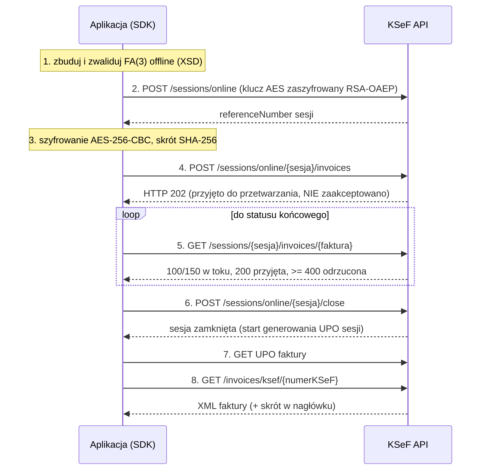

# Cykl życia faktury

Ten przewodnik opisuje, co dzieje się od zbudowania faktury do jej pobrania z KSeF, oraz jak SDK chroni przed duplikatami. Obejmuje sesję interaktywną (online). Sesja wsadowa (batch) **nie jest zaimplementowana**.

## Spis treści

- [Przebieg](#przebieg)
- [Wysyłka jednym wywołaniem](#wysyłka-jednym-wywołaniem)
- [Wysyłka krok po kroku](#wysyłka-krok-po-kroku)
- [HTTP 202 nie oznacza przyjęcia](#http-202-nie-oznacza-przyjęcia)
- [Duplikaty (kod 440)](#duplikaty-kod-440)
- [Niejednoznaczny wynik i uzgadnianie (reconcile)](#niejednoznaczny-wynik-i-uzgadnianie-reconcile)
- [Pobieranie faktury i błąd 21165](#pobieranie-faktury-i-błąd-21165)
- [UPO](#upo)
- [Zapytania o faktury i paginacja](#zapytania-o-faktury-i-paginacja)

## Przebieg



Klucz sesji (32 losowe bajty) i IV (16 bajtów) są generowane **dla każdej sesji**; klucz jest szyfrowany RSA-OAEP (SHA-256, MGF1-SHA256) kluczem publicznym o przeznaczeniu `SymmetricKeyEncryption`. Faktura jest szyfrowana AES-256-CBC z paddingiem PKCS#7; do KSeF trafiają skrót i rozmiar zarówno jawnej, jak i zaszyfrowanej treści. Materiał kluczowy jest trzymany tylko w pamięci.

## Wysyłka jednym wywołaniem

`submit()` wykonuje: walidację, otwarcie sesji, wysyłkę, oczekiwanie na status końcowy i zamknięcie sesji. Wraca **dopiero po statusie 200** i numerze KSeF.

```php
// PHP (examples/php/src/03-send-invoice.php)
$xml = Fa3InvoiceBuilder::sampleXml($nip, 'FV/EX/' . time());
$result = $client->sender()->submit($xml);
echo $result->ksefNumber;
$upo = $client->upo()->invoiceUpo($result->sessionReferenceNumber, $result->invoiceReferenceNumber);
$doc = $client->invoices()->download($result->ksefNumber);   // $doc->xml, $doc->hashVerified
```

```ts
// TypeScript (examples/typescript/src/03-send-invoice.ts)
const xml = await Fa3InvoiceBuilder.sampleXml(nip, `FV/EX/${String(Date.now())}`);
const result = await client.sender.submit(xml);
console.log(result.ksefNumber);
const upo = await client.upo.getInvoiceUpoByKsefNumber(result.sessionReferenceNumber, result.ksefNumber);
const downloaded = await client.invoices.getByKsefNumber(result.ksefNumber); // downloaded.hashMatches
```

`SubmissionResult` zawiera: numer KSeF, numer referencyjny faktury i sesji, skrót faktury oraz znacznik `upoAvailable`. Domyślny limit oczekiwania na status końcowy to 120 s (PHP: `SubmitOptions::$awaitTimeoutSeconds`; TypeScript: `submit(xml, { await: { timeoutMs } })`); po przekroczeniu zgłaszany jest `TimeoutException`. Odpytywanie zwiększa odstęp od 1 s do 5 s.

## Wysyłka krok po kroku

Gdy potrzebujesz kontroli (kilka faktur w jednej sesji, własna kolejka), użyj usługi sesji:

```php
$sessions = $client->sessions();
$session = $sessions->openOnline();                       // FormCode FA (3) domyślnie
$sent = $sessions->sendInvoice($session, $xml);           // waliduje XML, szyfruje, wysyła
$status = $sessions->awaitInvoice($session->referenceNumber, $sent->referenceNumber);
$sessions->close($session);
echo $status->ksefNumber;
```

```ts
const session = await client.sessions.openOnline();
const sent = await client.sessions.sendInvoice(session, xml);
const inv = await client.sessions.awaitInvoice(session.referenceNumber, sent.referenceNumber);
await client.sessions.close(session);
console.log(inv.ksefNumber);
```

Dodatkowo: `getStatus(sesja)`, `getInvoiceStatus(sesja, faktura)`, `listSessionInvoices` / `iterateSessionInvoices`, `listFailedInvoices`. Zamknięcie **pustej** sesji (bez faktur) kończy się na TEST statusem 440 „Sesja anulowana", nie 200. Samo `awaitInvoice` zgłasza `InvoiceRejectedException`, gdy status końcowy to 400 lub wyżej.

## HTTP 202 nie oznacza przyjęcia

Odpowiedź 202 na wysyłkę znaczy tylko „odebrano". Faktura może jeszcze zostać odrzucona (np. błąd walidacji po stronie KSeF, duplikat). SDK **nigdy nie zgłasza sukcesu bez statusu 200**: `submit()` i `awaitInvoice()` kończą się powodzeniem wyłącznie dla 200 i zwracają numer KSeF. Statusy: 100 i 150 oznaczają przetwarzanie, 200 przyjęcie, >= 400 odrzucenie.

## Duplikaty (kod 440)

KSeF odrzuca duplikat: klucz to NIP sprzedawcy, rodzaj faktury i numer faktury. Status 440 zawiera w rozszerzeniach `originalKsefNumber` i `originalSessionReferenceNumber`; SDK udostępnia je w `InvoiceRejectedException` (`statusExtensions()` w PHP, `statusExtensions` w TypeScript). To **ostatnia linia obrony**, nie pierwsza: zadbaj o unikalne numery i o uzgadnianie po niejednoznacznym błędzie.

## Niejednoznaczny wynik i uzgadnianie (reconcile)

Jeśli wysyłka kończy się limitem czasu, zerwaniem połączenia lub 5xx, **nie wiadomo**, czy KSeF faktury nie przyjął. SDK nie ponawia takiego żądania automatycznie (ponawiane bywa tylko HTTP 429, bo wtedy żądanie nie zostało przetworzone). Zamiast tego zgłasza `UnknownOutcomeException` z `invoiceHash` i numerem sesji.

**Dlaczego nie wysyłać ponownie na ślepo:** jeśli pierwsza próba dotarła, ponowna wysyłka tej samej faktury zostanie odrzucona jako duplikat (440) i stracisz informację o pierwotnym wyniku; jeśli przy ponowieniu zmienisz numer faktury, ryzykujesz dwa dokumenty o tej samej treści. Najpierw sprawdź stan:

```php
try {
    $result = $client->sender()->submit($xml);
} catch (UnknownOutcomeException $e) {
    $found = $client->sessions()->reconcile((string) $e->sessionReferenceNumber(), (string) $e->invoiceHash());
    // null = KSeF nie zna takiej faktury w tej sesji: dopiero wtedy wolno wysłać ponownie
}
```

```ts
} catch (e) {
  if (e instanceof UnknownOutcomeException && e.invoiceHash !== undefined && e.sessionReferenceNumber !== undefined) {
    const found = await client.sessions.reconcile(e.sessionReferenceNumber, e.invoiceHash);
    // undefined = brak faktury w sesji
  }
}
```

`reconcile` przegląda faktury sesji (stronicowanie tokenem kontynuacji) i porównuje skrót. Różnice między SDK:

| | PHP | TypeScript |
|---|---|---|
| Reconcile w `submit()` | jednokrotnie, po `reconcileDelaySeconds` (domyślnie 3 s) | do `reconcileAttempts` razy (domyślnie 3), co `reconcileDelayMs` (3000 ms) |
| Automatyczna ponowna wysyłka | tylko gdy `SubmitOptions::$resendIfAbsent = true` (domyślnie `false`) | **nigdy** |
| Gdy faktury nie znaleziono | ponowny zgłoszony `UnknownOutcomeException` (chyba że `resendIfAbsent`) | ponowny zgłoszony `UnknownOutcomeException` |

W adapterze Laravel `SubmitInvoiceJob` realizuje ten schemat z markerem w cache ([Laravel](laravel.md)).

## Pobieranie faktury i błąd 21165

Tuż po statusie 200 pobranie faktury może zwrócić HTTP 400 z kodem **21165** („przetworzona, ale jeszcze niedostępna do pobrania") albo rzadziej gołe HTTP 406; znika po kilku sekundach. `InvoiceService::download()` / `invoices.getByKsefNumber()` ponawia pobranie do **15 s** (w odstępach 1 s). Zaobserwowano to na żywo w obu SDK. Zachowanie przy niedostępności dłuższej niż 15 s sprawdzono tylko na lokalnym serwerze fault-injection. Kod 21165 występuje w OpenAPI wyłącznie dla `GET /invoices/ksef/{ksefNumber}`.

Wynik pobrania zawiera surowy XML i weryfikację skrótu: `hashVerified` (PHP) / `hashMatches` (TypeScript) porównuje skrót z nagłówka z obliczonym `base64(sha256(bajty))`.

## UPO

Urzędowe Poświadczenie Odbioru pobierasz dla faktury (PHP: `upo()->invoiceUpo(...)`, `invoiceUpoByKsefNumber(...)`; TypeScript: `upo.getInvoiceUpo(...)`, `getInvoiceUpoByKsefNumber(...)`) lub dla sesji (PHP `sessionUpo`, TypeScript `getSessionUpo`). SDK nigdy nie podąża za `downloadUrl` z odpowiedzi API (reguła SSRF); woła udokumentowane endpointy.

Ograniczenia: **podpis UPO nie jest weryfikowany kryptograficznie**. UPO z TEST nie przechodzi walidacji `upo-v4-3.xsd` z dwóch znanych powodów (nazwa podmiotu przyjmującego i element `ds:Signature` niedeklarowany w XSD). W PHP pobieranie UPO sesji i UPO po numerze KSeF sprawdzono tylko pod kątem kształtu odpowiedzi na lokalnym serwerze.

## Zapytania o faktury i paginacja

Metadane faktur pobierasz zapytaniem `POST /invoices/query/metadata`. Parametry: typ podmiotu (`Subject1` sprzedawca, `Subject2` nabywca, `Subject3`, `SubjectAuthorized`), rodzaj daty (`Issue`, `Invoicing`, `PermanentStorage`) i zakres dat.

```php
$filters = new InvoiceQueryFilters(SubjectType::Subject2, DateType::PermanentStorage, new DateTimeImmutable('-300 days'));
foreach ($client->query()->iterate($filters) as $meta) {
    echo $meta->ksefNumber, ' ', $meta->grossAmount, "\n";
}
// jedna strona: $client->query()->queryMetadata($filters, $pageOffset, $pageSize)
```

```ts
for await (const inv of client.invoiceQuery.iterateMetadata({
  subjectType: 'Subject2',
  dateRange: { dateType: 'PermanentStorage', from: new Date(Date.now() - 300 * 86_400_000) },
})) console.log(inv.ksefNumber);
// jedna strona: client.invoiceQuery.queryMetadata(filters, { pageSize, pageOffset, sortOrder })
```

Zasady:

- **Zakres dat to maksymalnie 100 dni (UTC).** Pojedyncze `queryMetadata` zgłasza `ConfigurationException` dla dłuższego zakresu. Iteratory (`iterate`, `iterateMetadata`) **dzielą zakres na okna po 100 dni** automatycznie i usuwają powtórzenia po numerze KSeF.
- Iteratory są leniwe (`Generator` / `AsyncGenerator`) i obsługują `hasMore` oraz `isTruncated` (zawężanie okna po osiągnięciu limitu 10 000 rekordów).
- Daty są jawnie konwertowane do UTC z przesunięciem.
- Rozmiar strony: TypeScript 10..250; w PHP `iterate()` domyślnie 100.
- Zapytania są tylko do odczytu, więc w razie błędu sieci mogą być ponawiane.
- SDK **niczego nie zapisuje**: trwały magazyn, deduplikacja i kursor to Twoja odpowiedzialność (w Laravelu: `InvoiceSink`).
- Rzeczywiste limity żądań i kontekstu: `limits()->context()`, `limits()->subject()`, `limits()->rateLimits()` (TypeScript: `limits.context()` itd.).

---

Built and maintained by LuroWeb.
