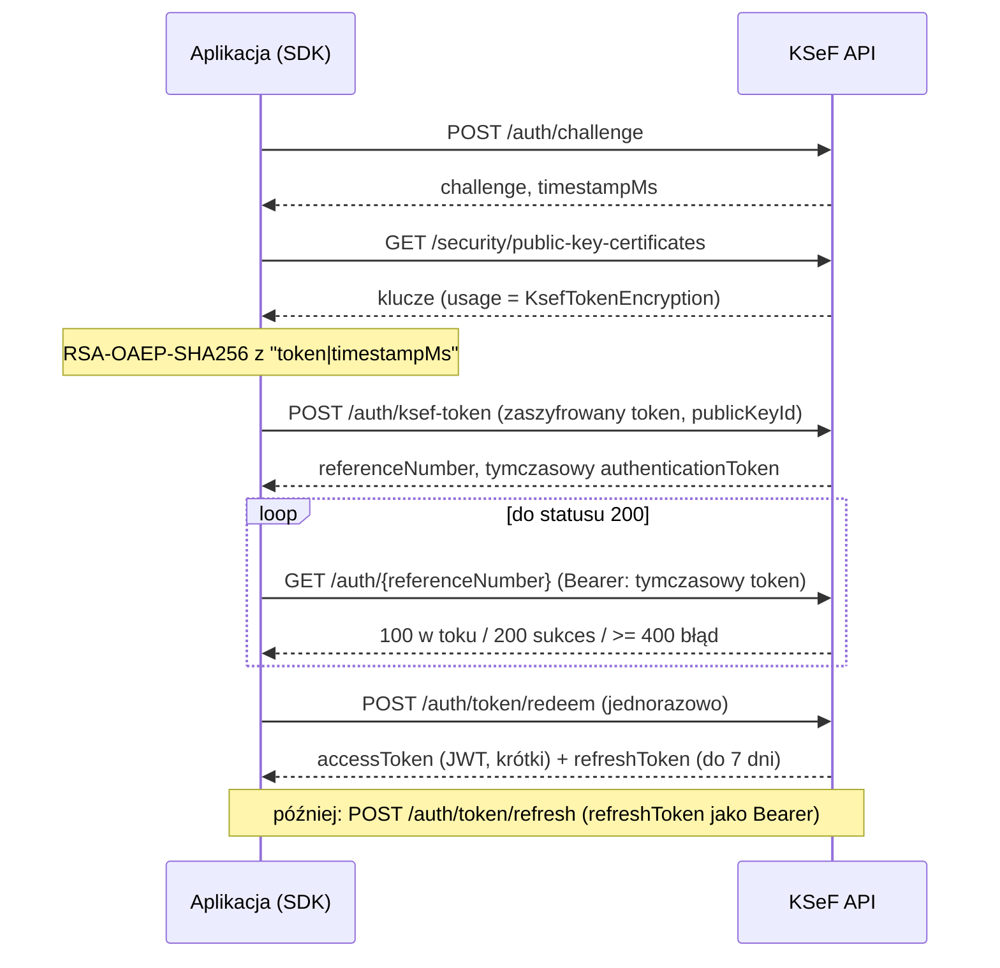
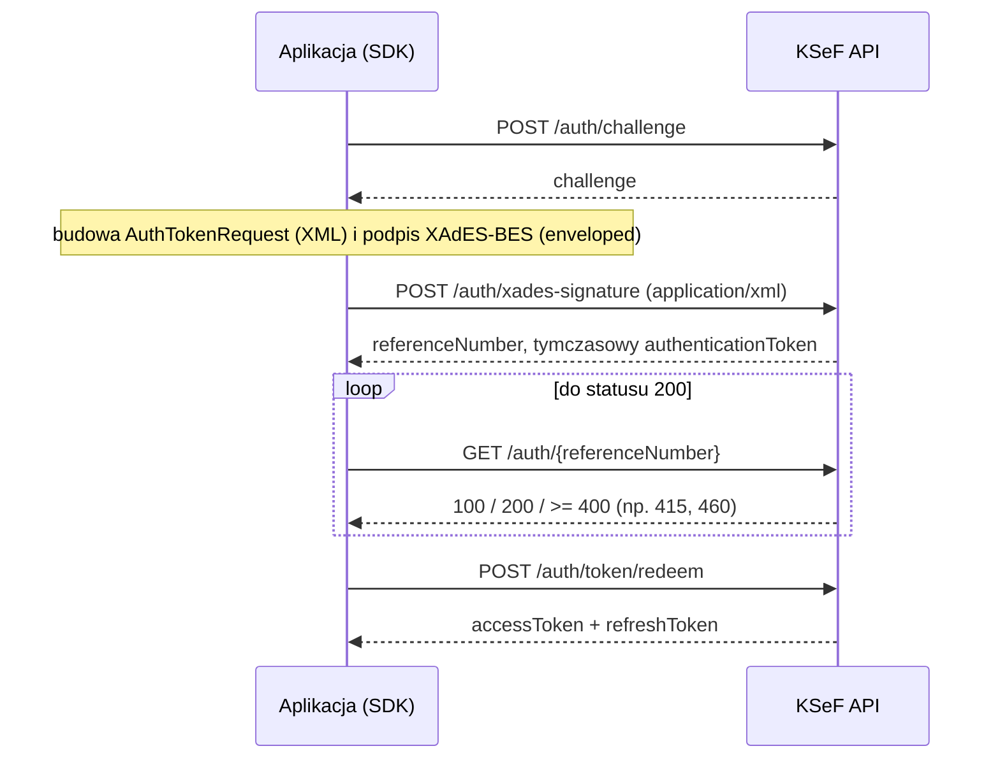

# Uwierzytelnianie

SDK obsługuje dwie metody logowania do KSeF API 2.0: **token KSeF** oraz **certyfikat** (podpis XAdES-BES). Ten przewodnik opisuje oba przepływy, to, co zostało zweryfikowane, ograniczenia oraz sposób zarządzania JWT.

## Spis treści

- [Którą metodę wybrać](#którą-metodę-wybrać)
- [Przepływ tokenem KSeF](#przepływ-tokenem-ksef)
- [Przepływ certyfikatem (XAdES)](#przepływ-certyfikatem-xades)
- [Co zweryfikowano, a co nie](#co-zweryfikowano-a-co-nie)
- [JWT, odświeżanie i ponowne logowanie](#jwt-odświeżanie-i-ponowne-logowanie)
- [Izolacja podatników (tenant key)](#izolacja-podatników-tenant-key)
- [TokenStorage](#tokenstorage)
- [Status 415 tuż po /testdata/person](#status-415-tuż-po-testdataperson)
- [Bezpieczeństwo sekretów](#bezpieczeństwo-sekretów)

## Którą metodę wybrać

| | Token KSeF | Certyfikat |
|---|---|---|
| Poświadczenie | długotrwały token tworzony przez `POST /tokens` | certyfikat + klucz prywatny |
| Klasa (PHP / TS) | `KsefTokenCredentials` | `CertificateCredentials` |
| Weryfikacja live (TEST) | tak | tak, ale tylko certyfikat **samopodpisany** |
| Status prawny | niejednoznaczny (patrz niżej) | niezależny od decyzji o tokenach |

**Status prawny tokenów KSeF (stan na 2026-11-13) jest niejednoznaczny.** Strona MF o certyfikatach KSeF i sierpniowa wersja Podręcznika KSeF 2.0 mówią, że token zostanie utrzymany bezterminowo (do odwołania przez użytkownika). Starsze materiały i obowiązujące rozporządzenie (Dz.U. 2025 poz. 1815, § 13, według zgłoszenia [CIRFMF/ksef-api#834](https://github.com/CIRFMF/ksef-api/issues/834)) wskazują 31.12.2026; w obiegu jest też projekt nowelizacji z datą 30.11.2027. Publikacji aktu zmieniającego nie potwierdziliśmy.

**Zalecenie:** dla nowych integracji produkcyjnych używaj **certyfikatu KSeF (Authentication)**. Jeśli korzystasz z tokenu, sprawdzaj komunikaty Ministerstwa Finansów i Dziennik Ustaw. Uwaga: logowanie certyfikatem wydanym w KSeF lub kwalifikowanym **nie zostało jeszcze sprawdzone na żywo** (patrz niżej).

## Przepływ tokenem KSeF



Szczegóły implementacji: token jest szyfrowany jako `"{token}|{timestampMs}"` kluczem o przeznaczeniu `KsefTokenEncryption` (RSA-OAEP z SHA-256 i MGF1-SHA256). `redeem` jest operacją jednorazową i **nie jest automatycznie ponawiany** po niejednoznacznym błędzie. Jeśli KSeF zwróci kod 21470 (nieznany klucz publiczny, np. po rotacji), SDK pobiera klucze ponownie i próbuje jeszcze raz (jednokrotnie); ta ścieżka została sprawdzona tylko na lokalnym serwerze, nie na żywo.

## Przepływ certyfikatem (XAdES)



- Dokument `AuthTokenRequest` używa przestrzeni nazw `http://ksef.mf.gov.pl/auth/token/2.1` (XSD v2-1). TEST przyjął też `…/2.0` z przykładów przewodnika; SDK używa 2.1.
- Podpis: XAdES-BES enveloped, RSA >= 2048 lub ECDSA >= P-256, skrót SHA-256.
- Błędy podpisu (kody 9101, 9102, 9105) wracają **synchronicznie** z `POST /auth/xades-signature` jako HTTP 400. Problemy z certyfikatem lub uprawnieniami (statusy 415, 460) widać dopiero podczas odpytywania statusu.
- **Certyfikaty offline nie są akceptowane** przez KSeF do uwierzytelniania.
- `subjectIdentifierType`: domyślnie `certificateSubject`. Opcja `certificateFingerprint` istnieje, ale nie była sprawdzana na żywo.

Przykład (PHP / TypeScript), certyfikat z plików:

```php
new CertificateCredentials(file_get_contents('cert.pem'), new SensitiveString($keyPem), ContextIdentifier::nip($nip));
```

```ts
new CertificateCredentials({ certificatePem, privateKeyPem, passphrase, context: Context.nip(nip) });
```

## Co zweryfikowano, a co nie

**Zweryfikowane na żywo (TEST, 2026-11-13, dane syntetyczne):**

- logowanie XAdES certyfikatem samopodpisanym osoby (`serialNumber = PNOPL-<pesel>`), RSA 2048 i ECDSA P-256, `certificateSubject`, kontekst `Nip`,
- utworzenie tokenu przez `POST /tokens`, logowanie tokenem KSeF, odświeżenie JWT,
- odczyt sesji uwierzytelnienia i listowanie tokenów.

**Niezweryfikowane na żywo:**

- certyfikaty kwalifikowane (pieczęć, podpis) i certyfikat uwierzytelniający wydany w KSeF,
- `certificateFingerprint`,
- konteksty inne niż NIP (`InternalId`, `NipVatUe`, `PeppolId`); dla `NipVatUe` oficjalny XSD uwierzytelniania ma wzorzec `TNipVatUE` kończący się dosłownym `$`, więc żadna wartość go nie spełnia, i test XSD pomija ten kontekst,
- środowiska DEMO i PRODUCTION.

## JWT, odświeżanie i ponowne logowanie

`AuthenticationManager` (dostępny jako `$client->auth()` w PHP i `client.authentication` w TypeScript) zarządza tokenami:

- `accessToken` (JWT) jest krótkotrwały, `refreshToken` ważny do 7 dni. SDK przechowuje parę i czas ważności zadeklarowany przez serwer.
- Odświeżenie następuje, gdy do wygaśnięcia zostało mniej niż **60 s** (`expirySkewSeconds`; w PHP przez `AuthOptions`, w TypeScript opcja klienta).
- Gdy odświeżenie zostanie odrzucone (401/403/400) lub refresh token wygasł, wykonywane jest **jedno** pełne ponowne logowanie.
- Równoległe wywołania tego samego podatnika dzielą jedną operację logowania lub odświeżania (*single-flight*). W TypeScript robi to mapa operacji w toku. W PHP robi to strażnik w procesie (współpraca z `Fiber`) oraz opcjonalna blokada między procesami (`KsefClientBuilder::lock()`); adapter Laravel podpina `Cache::lock`.
- Maksymalny czas oczekiwania na zakończenie asynchronicznego logowania: 120 s.
- SDK **nie dekoduje JWT do autoryzacji**; używa wyłącznie czasu ważności zadeklarowanego przez serwer do planowania odświeżeń. Autorytetem jest serwer.
- Znak `iat` w JWT ma rozdzielczość 1 s: odświeżenie w tej samej sekundzie zwraca identyczny access token.
- Błędy: brak uprawnień (status uwierzytelnienia 415) to `AuthorizationException`; pozostałe niepowodzenia logowania to `AuthenticationException`. Obie niosą kod statusu uwierzytelnienia (`authStatusCode()` w PHP, `authStatusCode` w TypeScript). Pętle ponawiania dla 415 powinny czytać właśnie to pole, nie `statusCode()`.

`$client->auth()->forget($credentials)` (PHP) i `client.authentication.invalidate(...)` usuwają zbuforowane tokeny; nie unieważniają sesji po stronie serwera. Do unieważnienia służy `client.logout()` (TypeScript) lub usługa sesji uwierzytelnienia (`authSessions`).

## Izolacja podatników (tenant key)

Pamięć podręczna tokenów jest kluczowana przez:

```text
sha256( środowisko | typ kontekstu | wartość kontekstu | metoda uwierzytelniania | odcisk poświadczeń )
```

Dwóch podatników (kontekstów), dwa różne poświadczenia lub dwa środowiska **nigdy nie współdzielą tokenów**. Odcisk poświadczeń to nieodwracalny skrót (SHA-256 tokenu, odpowiednio certyfikatu). Jeden `KsefClient` odpowiada jednemu zestawowi poświadczeń i jednemu kontekstowi; dla wielu podatników utwórz wiele klientów (Laravel: `KsefManager::tenant()`, NestJS: rejestr nazwanych klientów).

## TokenStorage

Domyślnie para JWT trzymana jest w pamięci procesu (`InMemoryTokenStorage`). Własną implementację podłączasz przez interfejs:

```php
// PHP: LuroWeb\KsefFoundry\Auth\TokenStorageInterface
public function get(string $key): ?TokenPair;
public function put(string $key, TokenPair $pair, int $ttlSeconds): void;
public function delete(string $key): void;
// KsefClient::builder()->tokenStorage($storage)
```

```ts
// TypeScript: TokenStorage
get(key: string): Promise<TokenPair | undefined>;
put(key: string, pair: TokenPair, ttlSeconds: number): Promise<void>;
delete(key: string): Promise<void>;
// KsefClient.create({ credentials, storage })
```

Zasady:

- Do magazynu trafia **wyłącznie** para JWT. Długotrwały token KSeF ani klucz prywatny nigdy tam nie trafiają.
- `ttlSeconds` to pozostały czas życia refresh tokenu (minimum 1).
- Refresh token to poświadczenie ważne do 7 dni: szyfruj dane w spoczynku i ograniczaj dostęp. Adapter Laravel szyfruje parę kluczem `APP_KEY`. Przykład `FileTokenStorage` w `examples/nestjs` zapisuje plik z uprawnieniami 0600 i jest tylko ilustracją; w produkcji użyj szyfrowanego cache lub magazynu sekretów.
- Magazyn współdzielony między procesami (Redis, baza) pozwala uniknąć zbędnych logowań, ale wymaga blokady logowania, by workery nie logowały się równocześnie.

## Status 415 tuż po /testdata/person

Na TEST endpoint `/testdata/person` działa z opóźnieniem kilku sekund. Logowanie XAdES tuż po utworzeniu osoby może zakończyć się statusem uwierzytelnienia **415 „Brak przypisanych uprawnień"**; to samo żądanie kilka sekund później przechodzi. SDK mapuje to na `AuthorizationException`, a przykłady ponawiają próbę (maks. 8 razy co 2 s):

```ts
const status = (e as { authStatusCode?: number }).authStatusCode;
if (status !== 415 || i >= attempts) throw e;
await new Promise((r) => setTimeout(r, 2000));
```

W produkcji ten sam status 415 oznacza realnie brak uprawnień kontekstu; nie ponawiaj go w nieskończoność.

## Bezpieczeństwo sekretów

- Token, klucz prywatny, JWT, refresh token i nagłówek `Authorization` są opakowane (`SensitiveString`) i nie trafiają do logów, wyjątków, `var_dump`, `console.log` ani `util.inspect` (zastępuje je `[REDACTED]`).
- Trzymaj token i klucz prywatny w menedżerze sekretów, nie w repozytorium.
- Używaj osobnych poświadczeń dla każdego środowiska ([Środowiska](srodowiska.md)).

Więcej: [Bezpieczeństwo](bezpieczenstwo.md).

---

Built and maintained by LuroWeb.
